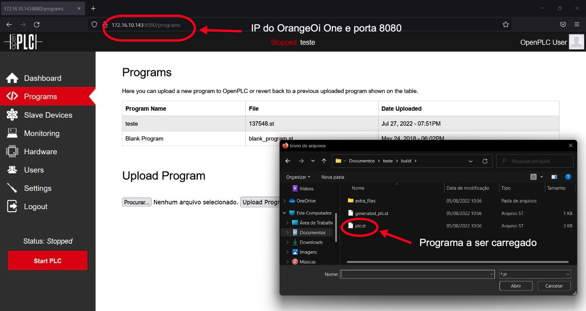
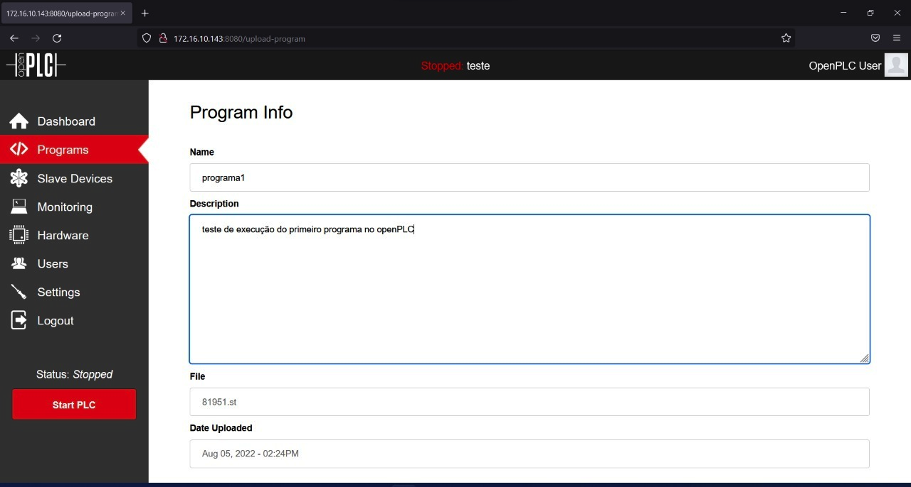
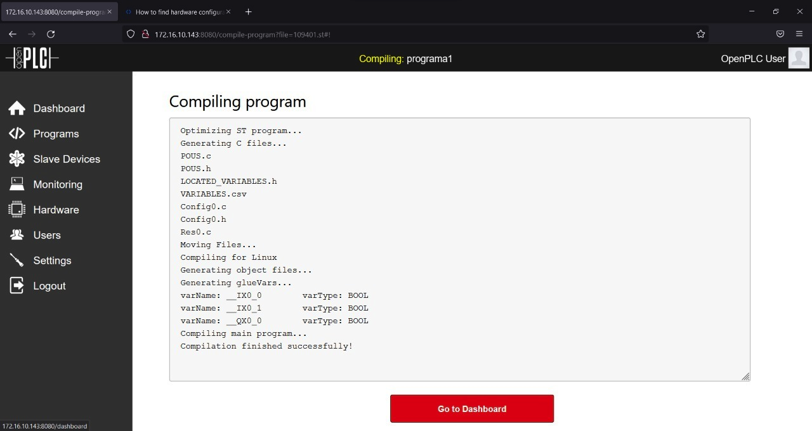

<td style="width: 20%;"></td>

# Índice 

* [Carregando programas para o OpenPLC Runtime](#Carregando-Programas-para-o-OpenPLC-Runtime)
* [Carregando programas no Runtime v4](#Carregando-programas-no-Runtime-v4)
* [Referências](#Referências)

# Carregando programas para o OpenPLC Runtime 

> Revisão de novembro de 2026. O procedimento com navegador descrito abaixo vale para o **Runtime v3** (porta 8080), usado nos exemplos deste repositório com E/S nos pinos GPIO do SBC. O Runtime v3 chegou ao fim de vida em abril de 2026. No **Runtime v4** não existe interface web: veja a seção [Carregando programas no Runtime v4](#Carregando-programas-no-Runtime-v4) ao final. Detalhes em [Versões e Compatibilidade](https://github.com/Epaminondaslage/OpenPLC#versões-e-compatibilidade).

## Runtime v3 (interface web)
 
A runtime do OpenPLC possui um servidor web integrado que permite configurar o OpenPLC e também fazer upload de novos programas para que ele seja executado. Microimplementações do OpenPLC Runtime (ou seja, versões do runtime que vão em microcontroladores e placas Arduino) não possuem o servidor web embutido. Em vez disso, todas as configurações de runtime para o micro runtime são feitas diretamente da caixa de diálogo de upload do OpenPLC Editor (veja Instalando o OpenPLC Runtime em Placas Microcontroladoras).

O servidor Web OpenPLC pode ser acessado abrindo um navegador da Web em seu computador e digitando o endereço IP do seu dispositivo OpenPLC na porta 8080.

Após efetuar login no servidor web, você verá o painel do OpenPLC com algumas informações sobre o programa em execução atual e os logs de tempo de execução.
  
    http://ip_do_raspberry:8080
    User    :openplc
    Password:openplc
  
Para carregar seu novo programa, vá para a seção Programas no menu à esquerda. Lá você deve ver uma lista de todos os seus programas enviados recentemente. Você pode reverter para um programa carregado anteriormente apenas clicando nele na lista e confirmando na próxima página. Para fazer o upload de um novo programa, clique em “Choose File”, selecione seu arquivo .st e clique em “Upload Program”.

<table border="0">
<tbody>
<tr>
<td style="width: 50%;"></td>
</tr>
<tr>
<td style="text-align: center;">Figura 01 - Fazer carga de programa no OpenPLC Runtime.</td>
</tr>
</tbody>
</table>

<table border="0">
<tbody>
<tr>
<td style="width: 50%;"></td>
</tr>
<tr>
<td style="text-align: center;">Figura 02 - Fazer carga de programa no OpenPLC Runtime.</td>
</tr>
</tbody>
</table>

Na janela que aparece, basta preencher algumas informações sobre o seu programa para que você saiba do que se trata na próxima vez que tentar carregá-lo novamente. Quando terminar, clique em “Upload program” para finalmente carregar seu novo arquivo .st no OpenPLC.

<table border="0">
<tbody>
<tr>
<td style="width: 50%;"></td>
</tr>
<tr>
<td style="text-align: center;">Figura 03 - Escolha do programa a ser carregado na Runtime do OpenPLC.</td>
</tr>
</tbody>
</table>

Assim que o arquivo for carregado, você será direcionado de volta à tela do painel e o status do OpenPLC mudará para “compilando”. Os logs sobre o processo de compilação são exibidos na caixa de logs de tempo de execução. Quando o processo de compilação estiver concluído, o status mudará para “executando” e seu novo programa será executado. Se houver um erro em seu programa, o status mudará para “parado” e os erros serão exibidos na caixa de logs de tempo de execução.

<table border="0">
<tbody>
<tr>
<td style="width: 50%;"></td>
</tr>
<tr>
<td style="text-align: center;">Figura 04 - Compilação do programa .st para ser executado no hardware selecionado.</td>
</tr>
</tbody>
</table>

## Enviando ao Runtime v3 pelo OpenPLC Editor v4

Com o OpenPLC Editor v4 não é obrigatório passar pelo navegador: na configuração de dispositivo do projeto, selecione o OpenPLC Runtime v3 como destino, informe o endereço IP do SBC e envie o programa pelo próprio Editor. A interface web na porta 8080 continua disponível para escolher a camada de hardware, acompanhar os logs e monitorar as variáveis.

# Carregando programas no Runtime v4

O Runtime v4 não tem servidor web: ele expõe uma API HTTPS na porta 8443, usada pelo OpenPLC Editor v4. Não há usuário e senha padrão.

1. Confirme que o computador com o Editor alcança o dispositivo na rede (por exemplo, com `ping ip_do_dispositivo`).
2. No OpenPLC Editor v4, abra a configuração de dispositivo do projeto e selecione o OpenPLC Runtime v4 como destino.
3. Informe o endereço IP do dispositivo e a porta 8443.
4. Na primeira conexão, crie o primeiro usuário do runtime. Nas conexões seguintes, faça login com esse usuário.
5. Compile e envie o programa. O Editor empacota o projeto, envia ao runtime e acompanha a compilação feita no dispositivo.
6. Inicie o PLC pelo Editor e acompanhe as variáveis no depurador integrado.

Atenção: segundo os desenvolvedores no fórum do projeto, o Runtime v4 não possui driver para os pinos GPIO do Raspberry Pi. O exemplo do botão e do relé deste repositório, ligado diretamente aos pinos do SBC, deve ser executado no Runtime v3. No v4, as E/S chegam por plugins (Modbus, OPC UA, S7comm, EtherCAT) ou por um bloco de função em Python que acesse os pinos.

# Referências

* Uploading programs to OpenPLC Runtime (geração v3). Disponível originalmente em: https://openplcproject.com/docs/2-2-uploading-programs-to-openplc-runtime/ (documentação migrada para https://old.autonomylogic.com/docs/).
* OpenPLC Runtime v4. Autonomy Logic. Disponível em: https://github.com/Autonomy-Logic/openplc-runtime. Acesso em novembro de 2026.
* Documentação do OpenPLC Editor v4. Autonomy Logic. Disponível em: https://edge.autonomylogic.com/docs/openplc-editor/overview. Acesso em novembro de 2026.
* Fórum do OpenPLC: OpenPLC V4 and Raspberry Pi. Disponível em: https://openplc.discussion.community/post/openplc-v4-and-raspberry-pi-13755921. Acesso em novembro de 2026.
